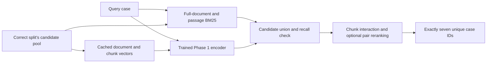

# Phase 7: six retrieval submissions with a measured training budget

Prepared 5 November 2026 from the supplied assignment PDFs, Phase 1–6 source files and saved archives, and the official Phase 7 evaluator fetched from the course Drive. This plan addresses **Phase 7 Prior Case Retrieval**; the reference to Phase 6 in the request is treated as a typo.

**Recommendation:** build a full-document lexical retriever plus a Phase-1-based neural retriever, combine their candidate lists, and apply a small amount of learned reranking where validation shows it helps. Start the main neural branch with **base 03**, using its existing bidirectional-prefix mode as a document encoder. Obtain six valid, genuinely trained methods early; spend the remaining compute on the best retrieval system. Longer training alone is not the proposed route to a better score.



No official Phase 7 query/candidate files were found in the workspace. Therefore corpus sizes, label cardinalities, baseline scores, throughput and achievable private F1 remain unmeasured. The first data/recall pilot below is a required gate before fixing final budgets. The supplied brief states a deadline of **7 November 2026, 11:59 PM**; use that as the planning deadline while checking the current course notice for changes.

## 1. The exact scoring contract

The assignment's section 13 and the official evaluator agree:

- Train queries use only `train_candidates.json`; dev queries use only `dev_candidates.json`; test queries use only `test_candidates.json`.
- Query files contain `text` sentence lists. Train/dev queries also contain `relevant_candidates`. The evaluator explicitly supports a mapping of query ID to a record containing those fields. Inspect the actual candidate-document schema before implementing its loader.
- Output is a **JSON object**, not Phase 6's list of summary records:

```json
{
  "0000021652": ["0000590455", "0000916840", "0001481813", "0001907199", "0000000987", "0000001566", "0000002886"]
}
```

- Exactly seven unique, nonempty string candidate IDs for every official test query, drawn from the test pool and ordered by predicted relevance. Preserve leading zeroes and original ID spelling; never round-trip IDs through integers.
- Submit only root-level `prediction.json` in each ZIP. Produce six different predictions from meaningful experiments, not six copies or rank-only permutations. At least five different adaptation techniques, compulsory LORMA, and one retrieval-specific knowledge-distillation experiment are required. Hyperparameter and pooling changes alone do not count as different adaptation techniques.
- Start every counted experiment from original Phase 1 weights and its matching tokenizer. No external pretrained retriever, pretrained reranker, external corpus, or external LLM/API. Research papers inform the design; their weights and datasets do not enter it. Include all four original bases across the six as a conservative continuation of the project-wide architecture comparison, even though section 13 is less explicit about all four than section 12.

Primary metric is **Micro-F1@7**, with micro precision and recall secondary. For Q queries, total cleaned gold labels G, and aggregate true positives TP:

`F1@7 = 2 TP / (7Q + G)`

The denominator is fixed for a given split. Maximizing official F1 therefore means recovering as many correct candidate IDs as possible in the seven slots across all queries. Do not transfer Phase 5's probability-threshold or variable-cardinality output logic. Changing the order of the same seven IDs does not change this scorer, although outputs must still be relevance-ranked.

Even an oracle may score below 1 if gold sets contain fewer or more than seven labels:

`global_oracle_F1 = 2 sum_q min(7, |Y_q|) / (7Q + G)`

For a shortlist C_K(q), its best possible final F1 is:

`shortlist_oracle_F1(K) = 2 sum_q min(7, |Y_q intersect C_K(q)|) / (7Q + G)`

Measure this ceiling before spending hours on reranking. A reranker cannot recover an omitted relevant case. Also report micro Recall@50/100/200 and Hit@7 to distinguish candidate misses from ordering mistakes. MRR/NDCG may be diagnostic, but checkpoint selection uses the official F1.

The original evaluator is saved at `reference/evaluate_phase7.py`, SHA-256 `1d8b311201f6938a0e93721fd62c527cd61f2816b6d76c9e115b1084c750ca93`. Its `--candidate-ids` input is a **list of IDs**, which must be generated from the appropriate document pool; do not pass the candidate-document mapping directly.

## 2. What the six earlier phases actually support

The bounded machine-readable review is in `PRIOR_PHASE_EVIDENCE.json`, generated by `review_previous_artifacts.py` from the archives without loading optimizer checkpoints.

| Saved evidence | Consequence for Phase 7 |
|---|---|
| Four genuine Phase 1 bases: 01 is an 8-block, width-768 causal model (~82M, context 1024); 02 is a 6+6 encoder-decoder (~61.3M, encoder 1024); 03 is a 24-block bidirectional-prefix model (52.2M, context 1280); 04 is local/global causal (55.1M, context 1536). | Use 03 and the encoder of 02 as natural retrieval encoders. Keep 01/04 causal masks intact and test trailing readout/last-token pooling. Parameter count or language-model loss alone does not identify the best retriever. |
| Phase 2 V3 selected hybrid OOF 0.4858 versus V2 0.4530; selected folds needed 18–24 epochs. Selection itself used those folds. | Do not impose one universally tiny epoch cap. Continue a model while genuine held-out retrieval gains justify it, and reserve an untouched check for the final design. |
| Phase 3 HighF1 report has OOF 0.4241 versus official-dev 0.5333. A later context-joint pilot retained the prior model and changed zero output labels after its gate failed. | Preserve the useful pilot gate. Added hierarchy or context is an experiment, not an assumed improvement. Small dev sets and repeated selection can be optimistic. |
| Phase 4 archive has six reports but all say `PROVISIONAL_0_FOLDS`. Its best reported dev F1 is 0.7551 for base-03 partial tuning. Some runs continued three epochs beyond their selected best. | Those local scores are not independent outer-validation evidence. Do not interpret them as proof that a retrieval architecture will generalize. Validate by query and save the selected checkpoint immediately. |
| Phase 5 archive has four completed reports: holdout macro-F1 0.3793, 0.3743, 0.3433, 0.3279. Separate submission ZIPs exist beyond the four reports, but this archive does not establish their measured training results. Its code uses four chunks during training versus twelve at inference. | Reuse atomic recovery and batching, but fix evidence-policy consistency and measure truncation. Do not silently increase inference coverage without validation. The artifact's missing reports are an evidence gap, not proof that later runs never finished. |
| Latest Phase 6 archive contains **all six** reports and `SIX_DISTINCT_PACKAGES_READY`. Selected epochs are 4, 3, 4, 2, 5, 4; complete histories contain 7, 6, 7, 5, 8, 7 validations. | Six completed methods are achievable with resume machinery. Additional epochs after the selected checkpoint need a stopping justification. Fast retrieval scoring can avoid generation's autoregressive validation cost. |
| Phase 6 base-03 AdaLoRA has full-tune BERTScore 0.8253 and untouched-audit 0.8262 over 352 cases; student full-tune is 0.8245. At least base-02 token audit reports 5,406 truncated training targets. | Prioritize base 03 for a retrieval pilot, not as a proven winner. Generation scores do not predict PCR F1. Do not use generated Phase 6 summaries as the main case representation: compressed evidence can lose retrieval cues. |

The reviewed report fields do not provide verified private Phase 4–6 scores. The user reports weak results after long Phase 4/5 runs; the archives establish several engineering/validation concerns, but do not isolate one causal explanation for those private results.

## 3. Data audit before choosing final settings

Download only the six official Phase 7 files from one pinned dataset revision using the Kaggle secret, or use the attached release. Record filenames, revision and SHA-256. Then:

1. Validate query/candidate schemas, string IDs, nonblank text, sentence-list shapes, duplicate JSON keys, and pool membership of every train/dev label. Mirror the official handling of blank gold entries; reject duplicate gold IDs rather than silently changing them. Record unlabeled/empty-label queries, which need explicit loss handling. Do not invent positives or silently drop them from evaluation.
2. Record query counts, candidate counts per split, positive-count distribution, token-length percentiles under each original tokenizer, and sentence/chunk counts. Distinguish a query with no gold from a corrupt missing-label record.
3. Audit overlap by original case ID, normalized exact text and near-duplicate text. Group duplicate **queries** for internal validation; report candidate overlap separately, because sharing a candidate across queries is normal. Never use dev/test relevance labels to train or mine negatives. Indexing candidate text for its own split's retrieval is expected inference, not label supervision.
4. Keep the supplied dev set for validation. Split its query groups into roughly 70% tuning / 30% final audit only if the size and label support allow a stable audit. Otherwise use a grouped train-query holdout for frequent selection, keep the complete official dev set for one final audit, and disclose its size. Every held-out query searches the correct full candidate pool, not a sampled set of easy negatives.
5. Preserve case facts, legal issues, statutory phrases, reasoning and the holding. Remove repeated navigation/header boilerplate conservatively. Do not globally delete numbers, legal sections or dates. Public IL-PCR describes citation-removed queries; inspect this actual course release before assuming explicit citations remain. An ID/citation lookup shortcut is not the main design.

No new unsupervised language-model pretraining is scheduled: Phase 1 already supplies the foundation, and the limited remaining time is better tested on supervised retrieval.

## 4. Main architecture and its quality gates

### 4.1 Full-document lexical retrieval

Build a separate index for each candidate pool, retaining stable ID-to-row maps. Start with document BM25 and passage BM25; score passages and aggregate them back to case IDs. Compare a small TF-IDF word/character branch only if lexical errors suggest spelling/formatting mismatch. All statistics come from the released candidate corpus for that split; no outside legal documents or pretrained lexical expansion models.

Use the complete query through weighted terms or section views rather than only its opening paragraph. Tune a very small set of BM25 length-normalization/query-term settings on tuning queries. Save document-only and passage-only baselines, full-pool top-seven predictions and shortlist recall. This CPU work establishes the baseline and is shared infrastructure, not one of the five neural adaptation methods.

### 4.2 Phase-1-based dense retrieval

Start with a **shared-weight base-03 dual encoder**. Encode a query and a candidate independently with the existing prefix mask set to the number of valid tokens, giving bidirectional attention throughout each encoded chunk. Use hidden states directly; bypass vocabulary logits and autoregressive decoding. Base 02 uses its existing `encode(ids, mask)` path and leaves the decoder unused.

Initial, provisional input policy:

- Sentence-aware chunks of about 384 original-tokenizer tokens, overlap about 64; retain original positions.
- Up to six deterministic views per long query/case: opening facts, middle coverage, issue/reasoning cues, and ending decision. Use the same selection and chunk count at fitting, validation and test. Track retained-token coverage by length bin.
- Masked mean pooling for bidirectional chunks, a learned 256-dimensional projection and L2 normalization. Compare last-token/trailing-readout pooling for causal 01/04. Never replace a pretrained causal mask with a bidirectional mask without a separate, validated architectural experiment.
- A normalized mean or small attention pooling of chunk vectors forms a cheap document vector for full-pool search. Test its quality before introducing a large new hierarchical network.

Whole-document lexical retrieval retains access to text omitted by the neural chunk budget. If measured misses arise from omitted middle paragraphs, test 8/12 views with the same training/inference policy on a short controlled pilot. Avoid encoding every case many times through six separate long-context models by default.

Candidate vectors are cached in batches at a **frozen checkpoint**. Cache keys include model/checkpoint hash, tokenizer hash, selector version, chunk budget, corpus hash and split. Recompute them after model updates; stale trained embeddings can make evaluation wrong. Token caches can be shared across methods using the same original tokenizer; trained vector caches generally cannot.

### 4.3 Candidate union and inexpensive interaction

Begin with a union of document-BM25 top 100, passage-BM25 top 100 and dense top 100, deduplicated by candidate ID. Measure union sizes and recall; the numbers are pilot settings, not a fixed requirement. Evaluate K around 100/200/400 and select the smallest budget whose shortlist-oracle F1 is close to the global ceiling. A working goal is at least 95% gold recall when feasible, but the oracle-F1 gap is the more relevant gate when there are many gold labels.

On that shortlist, compare document cosine with **chunk late interaction**: for each query chunk, find the best matching candidate chunk, then aggregate across query chunks with fixed or learned weights. This is a chunk-level adaptation of the late-interaction idea, not a claim to implement pretrained token-level ColBERT. Store a small number of candidate chunk vectors, so interaction is cheap after encoding. Check for long-document/max-pooling bias by length bin.

If promoting learned chunk interaction, train that scoring/aggregation path with the same positive/negative objective used for inference. Do not silently replace the optimized pooling score with an untrained inference-only head.

Fuse lexical and neural ranks with a fixed weighted reciprocal-rank rule. Limit tuning to a few global weights (for example neural weights 0.25/0.50/0.75), select on tuning data, and freeze before audit. A trained neural branch must materially affect each counted submission; setting its weight to zero would not demonstrate that method's retrieval experiment.

### 4.4 Optional cross-encoder reranker: promote only with evidence

After obtaining a good shortlist, pilot a base-03 query–candidate pair scorer on the best 32–64 candidates. Select matching query/candidate spans with a deterministic lexical policy; pack them with explicit query/candidate boundaries inside the original 1280-token limit. A fully bidirectional prefix plus a scalar relevance head can jointly assess the legal relationship. Start this supporting component from the original Phase 1 base, train on official train pairs, and document its cost separately under full fine-tuning.

Do not run a cross-encoder over the full query-by-corpus Cartesian product. Train on positives and sampled negatives, and batch shortlist inference across both GPUs. Increase reranker depth/number of span pairs only when full tuning F1 improves. If it improves train retrieval but not held-out top-seven membership, keep the cheaper hybrid system.

## 5. Six counted submissions

Use the same pool rules and evaluation protocol across slots. The five adaptation methods below are explicitly listed in Phase 7; this avoids relying on whether a technique named in an earlier phase also counts here.

| Slot | Original Phase 1 base | Technique | Training and role |
|---|---|---|---|
| 01 | **03**, 52.2M prefix hybrid | **Full fine-tuning** | Main neural retriever: train all used encoder weights plus projection, with multi-positive contrastive supervision. Add the companion pair reranker only if its pilot improves held-out F1. Primary high-score branch. |
| 02 | **01**, ~82M causal | **Partial/layer-wise tuning** | Unfreeze the final 2–4 of 8 blocks plus final normalization/projection; keep causal pooling correct. Different architecture and adaptation, useful for complementary ranking errors. |
| 03 | **04**, 55.1M local/global causal | **LORMA+** | Frozen base with multiplicative low-rank updates on selected attention projections and, if justified, MLP outputs. Mandatory method, evaluated with the same retrieval pipeline. |
| 04 | **02 encoder**, ~35.8M used parameters before retrieval head | **IA³** | Learn multiplicative key/value and intermediate feed-forward gates, initialized to one, plus projection. Omit unused decoder/logit work. Efficient bidirectional encoder comparison. |
| 05 | **03**, prefix hybrid | **Prompt tuning** | Frozen original backbone plus a small learned input prompt and retrieval projection. Prompt consumes context; attention masks/positions must include it. This is a genuine soft-prompt method, not a changed hard-text instruction. |
| 06 | **02 encoder** student | **Retrieval knowledge distillation** | Start again from original base 02, train a compact encoder on gold relevance plus cached teacher rankings/margins. Use the strongest validated larger/stronger Phase-1-based retrieval teacher. Compare with a matched gold-only student control. |

Base 02's active encoder is approximately 35.8M parameters from the saved 6-layer/512-width configuration; count the actually retained modules plus the retrieval head in implementation. It is smaller than the base-03 teacher even though base 02's complete encoder-decoder has 61.3M. Report loaded, active, and trainable parameters separately. A frozen large backbone is not a smaller model merely because few parameters train.

LORMA implementation must match the paper's additive rank-inflation variant: `W_eff = (I + alpha/r * B A) W0`, with `B` initialized to zero. For biased layers, implement and document the bias convention explicitly; verify the transformed weight path rather than silently multiplying an unintended bias. Test rectangular projection shapes, identity at initialization, gradients and merged/unmerged parity. IA³ must actually gate the intended activations. Prompt gradients must pass through the frozen network: wrapping that network in `no_grad()` would prevent learning the prompt.

Each method gets enough real training to cover the fitting queries and produce its own checkpoint and top-seven output. Rank/learning-rate variants do not fill a missing slot. Compare prediction hashes and top-seven **sets**; order-only changes are not useful diversity. If a method collapses to the common baseline, fix the adaptation/optimization rather than manufacture differences.

## 6. Losses, negatives and distillation

### Train for retrieval, with multiple positives

Use a shared candidate bank for each legal training pool. For each query, rotate positives so all its gold cases receive supervision, and exclude **all known positives** from negative sets, including positives that appear elsewhere in the batch. Deduplicate repeated candidates and mask near-identical cases conservatively.

An initial loss is the average positive-versus-negatives softmax:

`L_gold(q) = -mean_{p in P_q} log [ exp(s(q,p)/tau) / (exp(s(q,p)/tau) + sum_{n in N_q} exp(s(q,n)/tau)) ]`

This avoids forcing the model to prefer one known positive over another. Compare only a small temperature range if needed. A listwise/pairwise reranker loss is a separate supporting component; do not begin with a large custom differentiable F1 objective before the simple retrieval loss works.

Start with 1–2 sampled positives, two BM25 semi-hard negatives and two random negatives per query, plus masked in-batch negatives. Mine dense hard negatives **once** after the first useful checkpoint, then refresh only if recall/learning stalls. Sample hard candidates across ranks rather than repeatedly choosing only the hardest case. Unlabeled high-similarity cases can be false negatives; soften their weight or use teacher guidance, without adding invented gold labels. Never mine against dev/test relevance.

If using two-GPU DDP for contrastive training, collect candidate vectors/positive masks across devices correctly, retaining gradients as intended. **Gradient accumulation alone does not enlarge the in-batch negative pool.** Validate the distributed loss against a small single-process reference, particularly when two queries share a positive.

### Distill retrieval scores, not generated summaries

Choose a trained teacher after measuring retrieval F1/recall. Prefer the full-FT base-03 retriever or its validated pair reranker; base-01 partial can be the teacher if it is demonstrably stronger. Cache scores only for train queries and a fixed list containing positives and lexical/dense hard negatives. Hash the teacher checkpoint and candidate lists.

Train the original-base-02 encoder student with `L_gold + lambda * L_KD`. Pilot either temperature-scaled KL over each candidate list or a margin loss between teacher and student positive-negative score differences. Normalize/calibrate score scales when architectures differ. Keep gold relevance as an anchor; teacher mistakes must not overwrite labels. Start with a modest KD weight and increase only on tuning evidence. The matched gold-only student should have the same initialization, architecture and update budget; otherwise the effect of distillation is confounded with model or training-time changes.

## 7. Compute policy: spend time where F1 can improve

### Throughput pilot

Before long fits, overfit 16–32 real training queries to catch missing gradients, ID mismatches, positive-mask bugs, pooling mistakes and collapsed embeddings. Then benchmark 128–256 representative short/long cases with both GPUs.

- Warm up several batches; time multiple steady-state batches. The earlier single-pass batch probe is not sufficient for choosing a production batch size.
- Increase microbatch/token budget until useful throughput stops improving or memory approaches roughly 80–85%, leaving room for optimizer/DDP/evaluation work. Do not retain Phase 6's artificial 1–4 microbatch search as a maximum.
- Measure completed query-candidate examples/sec, tokens/sec, validation/indexing seconds, peak memory, CPU tokenization time and archive time. Estimate a complete six-method run from these measurements before launching the longest job.
- Use mixed precision appropriate to the device, token caching, length buckets, pinned transfers and vectorized similarity. Skip language-model logits. Enable activation checkpointing only if its extra computation buys a better useful batch/context budget.
- Compare a two-GPU DDP job against one independent method per GPU. Use the faster total-work configuration; DDP is valuable for full tuning/global negatives, while independent smaller methods can use both GPUs with less synchronization overhead. Do not run two full jobs each trying to claim both GPUs.

### Training and stopping gates

An initial allocation is 2–4 query passes for the main full/partial models and 1–3 for the smaller methods, **subject to validation**. These are starting budgets, not claims about the actual data's convergence. Use lower learning rates for pretrained weights (pilot around 1e-5–3e-5 full FT) and larger rates for new projections/gates/prompts (around 1e-4–5e-4), 5–10% warmup, clipping and a decaying schedule. Diagnose unstable loss before spending a complete epoch.

Evaluate a fixed, representative tuning subset after about half a query pass or a measured update interval. Full-pool retrieval is essential even on a query subset. Use cheaper shortlist scoring for frequent checks, and rebuild the full tuning index/score at promising checkpoints and at least once per main-model pass. Track shortlist recall as well as final F1; train loss by itself cannot select the checkpoint.

After the initial learning period, stop extra passes when **three consecutive comparable validations** yield no meaningful gain in recovered top-seven positives, including one check after learning-rate decay or a single negative refresh. Compare improvements in actual TP counts: a single query-label change may be noise, while a consistent multi-query gain is worth continuing. If the recent trend remains positive, extend the winning run within the remaining budget. A hard wall-time cap only ensures there is time left to complete the other methods.

Use paired query bootstrap estimates on frozen dev predictions for major promotions, with fixed resamples, and inspect the queries whose top-seven sets changed. Do not chase tiny differences by running many seeds or an unrestricted blend grid. Confidence intervals are descriptive when the same tuning set has already selected many choices.

Suggested initial **compute allocation**, recalculated after the pilot:

| Work | Share of available GPU time |
|---|---:|
| Main full-FT base-03 retriever and one justified reranker pilot | 30% |
| Base-01 partial and base-04 LORMA | 25% |
| Base-02 IA³ and base-03 prompt tuning | 15% |
| Teacher-score caching, matched student pilot and KD | 15% |
| Inference, audit, recovery and unfinished-stage reserve | 15% |

If reranking does not improve held-out membership, return its allocation to candidate recall or the strongest dense model. If all neural losses improve while retrieval does not, investigate evidence selection, negatives and pooling before extending epochs.

## 8. Validation, final selection and optional refit

Keep the final audit untouched until the retrieval policy, chunk budget, shortlist size, stopping choice and small fusion grid are frozen. Report official micro F1/P/R, aggregate TP, candidate-recall ceiling, gold-count bins and document-length bins. Manually inspect a fixed set of misses: wrong factual relationship, matching statute but different issue, lost reasoning chunk, overly generic precedent, and duplicate/boilerplate matches.

Package each slot as soon as it finishes. After all six exist, compare the top one or two systems on the full tuning set and perform the predeclared audit. An ensemble is optional and must beat the strongest single system on held-out queries; it does not replace a required adaptation method. Shared lexical/neural infrastructure must not make all counted outputs identical.

Only then consider a **single** final refit of the best design on train plus released dev labels, if the rules and remaining time permit. Continue to use each query's corresponding candidate pool during training, with a masked pool-specific candidate bank; do not merge pools into an invalid retrieval universe. Use the selected number of query passes/update exposure, not a blind extra epoch count, and report the audit as a pre-refit estimate. Save the six validated packages before any refit. If time is tight, submit those rather than wait for a partially trained refit.

## 9. Implementation and recovery structure for the later notebook

The requested deliverable here is the strategy, not another training launch. The implementation should follow this stage order:

`prepare/schema audit -> split-specific sparse indexes -> baseline/recall gate -> original-base token caches -> throughput/gradient pilot -> per-slot train/mine/evaluate -> per-slot test rank/package -> teacher cache/KD -> final audit/report`

Reuse Phase 6's segmented process orchestration and atomic save/restore. Improve these points:

- A manifest per slot stores original checkpoint/tokenizer hashes, method, data/pool/split hashes, selector, architecture, negative-list version, seed, optimizer step and query cursor.
- Save model/adaptation, optimizer, scheduler, scaler, RNG, negative-sampler/index version and best metric every 5–10 minutes and at every evaluation/segment boundary. Keep one previous known-good checkpoint. Synchronize DDP save/stop decisions across ranks.
- Finish a segment in roughly 15–20 minutes, then update `CS781_Phase7_All_Artifacts.zip` after workers exit. Keep immutable original-base files shared on disk, and avoid saving redundant candidate tensors/optimizer copies in many folders. Exclude download caches/temp files; store checksums and finished submission ZIPs.
- Save partial candidate-encoding shards, teacher scores and test rankings by original IDs. Resume unfinished IDs only. Never use a stale vector shard after changing model weights.
- Separate package reuse from training reuse. Completed slots should be verified and skipped; rerunning Run All should not retrain them or repeatedly re-encode their entire pools. A code change must either be compatible with the saved config or start a clearly new experiment.
- Log the real remaining session time and reserve an archive margin. Restarting a cell's local timer does not extend Kaggle's actual backend session. Save/download or commit the archive before the session ends.

Write six files `CS781_Phase7_Submission_01.zip` through `_06.zip`. For every file, reopen the ZIP and JSON with the official strict duplicate-key loader; verify the exact query set, seven unique IDs, pool membership, nonempty strings, deterministic ranking and output hash. Produce dev `candidate_ids.json` separately and run the official evaluator on dev predictions. Test accidental integer IDs, missing queries, duplicate candidates and cross-split pool IDs before packaging real outputs.

## 10. Work order for 5–7 November

| Date | Required outcome | Decision |
|---|---|---|
| **5 Nov** | Obtain and validate Phase 7 files; lexical/full-pool baseline; shortlist ceiling; base-03 full and base-01 partial pilots; first genuine trained package(s). | Fix recall/representation failures before training all methods. Measure the whole pipeline's duration. |
| **6 Nov** | Complete full/partial/LORMA/IA³/prompt outputs; train-only teacher cache and student KD; six valid files saved as early as feasible. | Weak methods receive genuine bounded training; extra time goes to validated improvements in the best systems. |
| **7 Nov** | Frozen final audit, optional justified blend/refit, final ID/ZIP checks and manual Codabench uploads with time for feedback. | The brief allows up to 10/day and 40 total; six are required. Queues can take 15–30 minutes or longer under load, so submit finished files progressively. |

If the first session cannot complete the measured plan, reduce reranker/extra-ablation work first and preserve the six mandatory techniques, correct pool semantics and full-pool evaluation. Optimize training efficiency without pretending that a shorter unfinished method is a completed high-quality experiment.

## Sources and evidence boundaries

- Supplied `Capstone Document 1.pdf`: section 13, PDF pages 37–42, and general submission requirements on PDF pages 2–3. Supplied `Capstone Document 2.pdf`: official evaluator source and reporting requirements. These local copies are dynamic-course snapshots.
- [Official course Phase 7 evaluator](https://drive.google.com/file/d/19Raf18n0ysaIsvaMOwtt56az7qpF-lOC/view), retrieved 5 Nov 2026; exact saved copy and hash above.
- Local four Phase 1 recovery manifests/model sources; Phase 2 V3 report; Phase 3 runners and HighF1/hierarchical/context-joint reports; Phase 4/5 runners and all-artifacts reports/histories; Phase 6 runner and latest complete archive. Local scores are not interchangeable across tasks.
- [IL-TUR PCR task documentation](https://exploration-lab.github.io/IL-TUR/docs/tasks/prior-case-retrieval-pcr/): legal factual/precedent matching and anonymized/citation-removed query context. Its public corpus is background information, not permission to add data to this course release.
- [DPR](https://aclanthology.org/2020.emnlp-main.550/): dual encoders and retrieval training motivation. [ColBERT](https://arxiv.org/abs/2004.12832): precomputable independent encodings with later interaction. Our proposed long-case chunk adaptation must be tested on this data.
- [LoRMA](https://aclanthology.org/2025.findings-acl.527/), particularly Eq. 8: multiplicative adaptation with additive identity inflation. [IA³](https://arxiv.org/abs/2205.05638): activation rescaling as a distinct adaptation method.
- [Cross-architecture ranking distillation](https://arxiv.org/abs/2010.02666): retrieval-specific teacher margins and score-scale differences. Only our allowed Phase-1-based teacher's scores would be used.

No Phase 7 score is claimed by this plan. The first measured deliverables are baseline F1, shortlist recall/oracle ceiling, and neural-pilot F1/runtime; they determine where additional training is useful.
